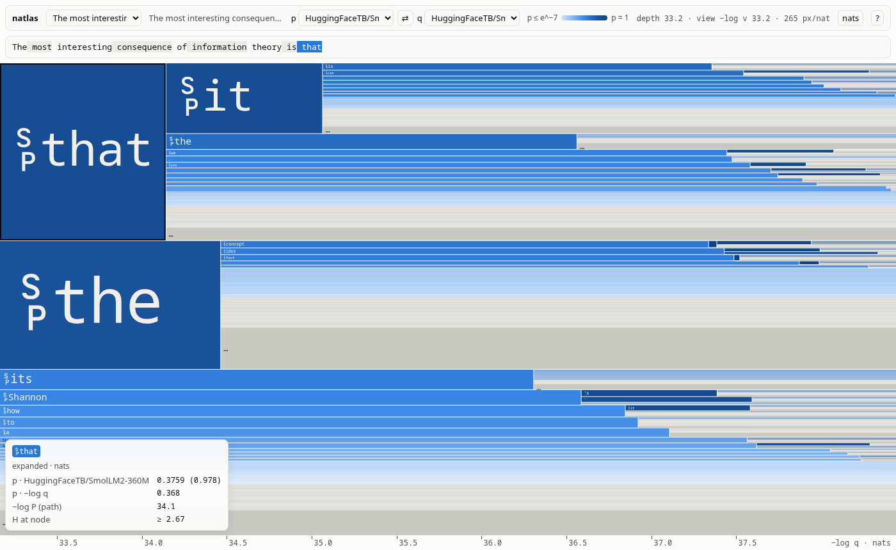
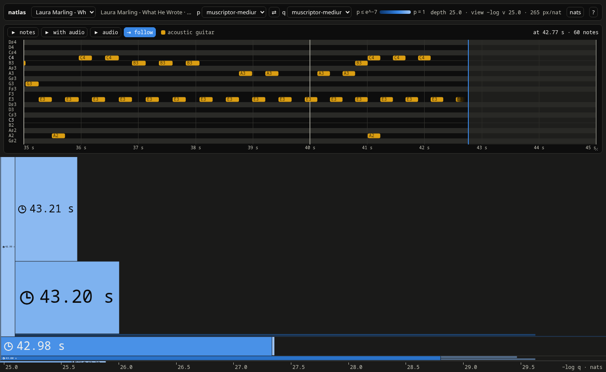
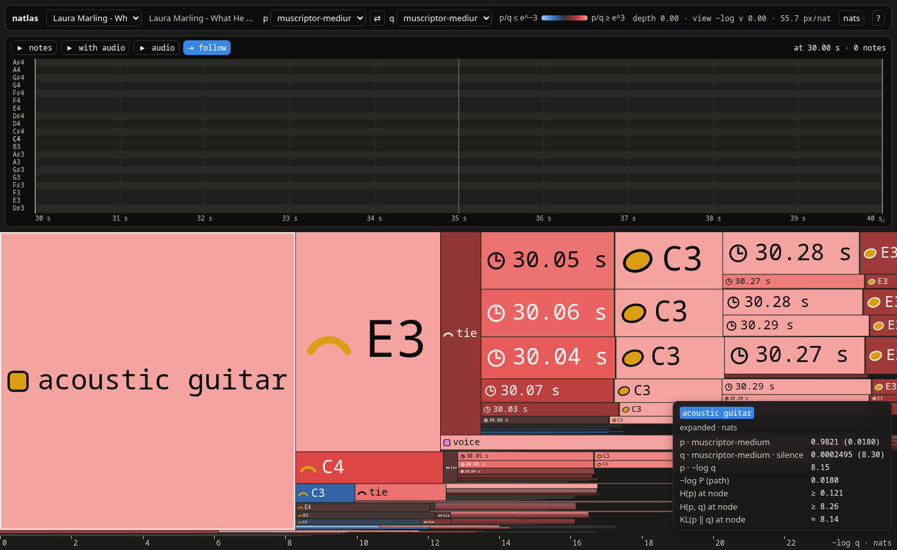

# natlas

A web navigator for distributions over integer sequences, built as the visual client for
[natwalk](https://github.com/khoda81/natwalk). It knows nothing about tokens or
models: a tree is nodes whose children partition their interval, with one
weight per child under each *measure*, and children are numbered labels whose
meaning comes separately.



A language model's tree of texts: each box is a token, as tall as its
probability and as wide as its surprisal, so a node's boxes cover its entropy.



[MuScriptor](https://github.com/muscriptor/muscriptor) transcribing a
recording: the boxes are its events (time shifts, here), and the panel above
is a piano roll of the path to the hovered box.



The same model with q hearing silence instead: red boxes are events the audio
made likelier, and their extra width is what it told the model, KL(p‖q).

## The picture

Pick one measure **p** and one measure **q** (by default the same). A slot of
node N is a box

- **height** ∝ p: N's interval split by p, recursively, so a box's height is
  the p-probability of its whole path;
- **width** = −log q nats, starting where N's own box ends, so a box's left
  edge is the q-surprisal of its path.

A node's slot boxes therefore cover N's mass × Σ p·(−log q) in area: entropy
when p = q, cross-entropy otherwise. Comparing p with q = p shows KL(p‖q) as the
extra area. Color repeats the conditional p when p = q and shows ln(p/q) per
slot otherwise, red where q under-weights it.

## The canvas

Depth is unbounded, horizontal scale is unbounded (it is the base of the log),
and vertically the view never leaves the root interval. The view height is
coupled to depth: with the left edge at x nats the view spans e^−x of the
root, so a node at the left edge keeps the same screen height however deep it
is. Scrolling deeper is therefore also zooming in.

Absolute vertical coordinates would lose precision a few dozen nats deep, so
the camera is anchored to a nearby slot boundary instead, and every position is
a same-sign sum of masses outward from it (see `core/src/layout.rs`). The tests pin
exact geometry 80 halvings deep.

| input | motion |
|---|---|
| wheel, ← → | deeper / shallower, zooming about the pointer |
| drag | grab and move |
| shift + wheel, ↑ ↓ | along the interval |
| ctrl + wheel, pinch, + − | horizontal scale, about the left edge, leaving the vertical view alone |
| double-click | glide until a box stands like the root, its children filling the view |
| hover | select a branch by height, then depth; empty space keeps the deepest known subtree selected |
| inspector editor | search text as you type; select a result or press Enter to anchor there |
| 0 · s · b | root · swap p and q · nats/bits |

## Protocol

`proto/natlas/v1/natlas.proto`. A distribution is over sequences of unsigned
32-bit integers. The empty sequence is the root; appending one integer names
a child. The complete sequence is its identity across the client, measures,
server restarts and saved views. Numeric node IDs inside the core are only
local storage indices and never go over the wire.

Each server serves one measure through two Connect RPCs:

- `Expand(path, horizon)` streams `Edge { label, odds }` directly, heaviest
  first, down to conditional probability 2^−horizon. Horizon 0 lists nothing.
  Each edge's weight is a fraction g of the previous child's, sent as the
  log-odds of g in steps of horizon·ln 2 / 2³¹ nat. Every stream prefix is
  valid; unlisted mass remains a tail.
- `Search(text)` maps text to its complete integer path, using the model's
  tokenizer. The browser searches on input and anchors only when a result
  is selected. Music services return `unimplemented` for text search.

Comparing p with q means asking both servers about the same paths. The client
asks for enough children to resolve their height in pixels under p and their
width under q. Missing q weights are upper bounds, so their drawn widths are
lower bounds. Listed branches use the same colors whether their children are
known yet. Tiny adjacent branches merge into borderless, area-preserving
runs while selection still resolves their individual integer labels.

A `Snapshot` records expansions by complete path with `format_version = 2`.
Recorded search includes listed leaves as well as expanded nodes, and returns
an exact match, a completion, or the deepest recorded prefix. Text with no
recorded match shows an error. Old handle-based recordings must be converted:

```bash
uv run scripts/migrate-snapshots.py           # all public/data/*.pb
uv run scripts/migrate-snapshots.py tree.pb   # selected files
```

The converter resolves the old parent handles without model inference and
keeps originals in `.snapshot-backups/`. Regenerating data is also supported.
The wire format changed; the browser and live services must be updated together.

The browser saves the smallest known anchor covering the viewport, its integer
path and camera position, horizontal scale and p/q measures to local storage.
Keys include source URLs (or dropped file contents). Reload reconstructs the
path on demand; if a recording no longer reaches it, the view falls back to
its deepest available ancestor. A server does not choose the initial tree or
send a starting prompt.

## Live

```bash
bun run live      # SmolLM2-360M on the GPU, at http://localhost:8421
cd export
uv run serve.py --p HuggingFaceTB/SmolLM2-360M \
  --q context:4 --q temperature:1.6
```

`export/serve.py` loads the model and serves each measure as its own `Natlas`
service, `/0/` for the model and `/1/`, `/2/`, … for the `--q` measures, over
the Connect protocol. The root is the empty text; the start-of-text token is
internal to the model. `/manifest.json` describes the measures and
`/labels.json` holds each token's bytes. With `bun run dev` running, the page
finds a local server and lists it first; `?server=URL` points it elsewhere.
Use the inspector editor to find text and select the result to start there.

`export/service.py` owns the model-independent RPC handlers and the bounded
LRU policy for complete model distributions. Both language and music servers
store those distributions in the native Rust tree and encode responses with
the same Rust codec as the browser. The model runs on worker threads with a
lock protecting inference and cache updates.

Models load in float32 by default, which is both more precise and, on a GTX
1660 Ti, about 5× faster than float16; `--dtype` trades that for memory on
larger models.

`--p` also takes a `.gguf` file, which llama.cpp runs with every layer on the
GPU (`--gpu-layers`, and `--n-ctx` for the deepest path it can hold).
llama-cpp-python is built for CUDA on first run, which takes a while. A
request that shares a prefix with the previous one reuses its KV cache, so
walking down a path costs one token per step.

```bash
uv run serve.py \
  --p ~/.cache/huggingface/hub/models--Qwen--Qwen3-4B-GGUF/snapshots/*/Qwen3-4B-Q6_K.gguf \
  --q temperature:1.6
```

### Music

```bash
cd export
uv run scribe.py song.mp3 --at 30 --q silence
```

`export/scribe.py` serves [MuScriptor](https://github.com/muscriptor/muscriptor)'s transcriptions of a
recording from `--at` seconds on. MuScriptor writes music 5 seconds at a time,
as MIDI-like events: a tie prologue naming the notes sustained into the
window, then time shifts, instruments, note-ons and note-offs, pitches, drum
hits and an EOS. A path is one transcription of the whole recording, scrolling
through the windows as `TranscriptionModel.transcribe` does, as in natwalk's
MuScriptor demo: EOS is the model's decision to move on, each later window's
prologue is forced from the notes the path leaves sounding (probability one),
a window at MuScriptor's 2000-event limit gets a forced EOS, and the last
window's EOS ends the path. A path's probability is the one MuScriptor's
chunked decoder gives that transcription.

The measures are the model (`--p small|medium|large`) and each `--q`: another
size hearing the same audio, `silence` for the model hearing nothing (p
against it shows what the audio told the model), `instruments:piano,drums`
for the model told what to expect, or `temperature:T`. Each measure keeps a
few KV caches (`--slots`), one per window in reach, stepped back to the prefix
a request shares with what they hold.

Its `/labels.json` is a notes file rather than an array of bytes:
`{"kind": "notes", "frameRate", "window", "windows", "at", "audio", "events":
[[type, value], …], "instruments", "drums"}`. The client reads its kind and
draws each box as its event: a note head for a note-on and a ring for a
note-off in the instrument's color, a tie, a drum ×, a clock with the time in
the recording for a shift, a stop for an EOS. The panel above the canvas
becomes a piano roll of the path, following the window being written: the
hovered event's notes are outlined and a cursor marks the time written so
far. Drag its corner to make it taller; wheel or drag to scroll pitches and
time, ctrl + wheel to zoom time, double-click to follow again. Hovering a
note names it. Space plays the transcription in view, shift + space plays it
over the recording (`/audio.wav`).

## Data

Datasets live in `public/data/` (git-ignored) with a `manifest.json`: per
dataset, one `.pb` snapshot per measure and a `.labels.json` of label bytes,
base64 in a JSON array. A token can hold part of a character, so the client
decodes a path's bytes together and shows each box as the characters its
token finishes after its ancestors, or as hex where it finishes none.
Snapshots, with or without a labels file, can also be dropped onto the page.

```bash
bun run data      # Zen of Python character n-grams, no ML needed
cd export
uv run hf.py      # Qwen3-1.7B as p, Qwen3-0.6B as q
uv run hf.py --p HuggingFaceTB/SmolLM2-360M --tokenizer HuggingFaceTB/SmolLM2-360M \
  --q context:4 --q temperature:1.6
```

Both use natwalk's own search to discover the tree, then evaluate the other
measures on the same paths, each listed in its own order down to the bit
below its coverage. `hf.py` roots the tree at the empty text too: it records
the path down to the prompt where natwalk's discovery begins. The browser
chooses its own anchor through text search or its saved view. A q measure is another model with the same
tokenizer, `context:N` (p seeing only its last N tokens) or `temperature:T`.

## Development

The source is split by responsibility:

- `core/`: Rust tree, cached listings and derived slots, shared wire codec,
  anchored geometry, best-effort picking and covering-anchor queries.
- `src/core/`: thin TypeScript adapters to that core, compiled to WebAssembly.
- `src/data/`: live/recorded sources, dataset loading and completion-driven
  expansion scheduling.
- `src/readings/`: text and music interpretations of integer labels.
- `src/ui/`: canvas drawing, camera controls, inspector/search and saved views.
- `export/`: Python model adapters, Connect service and snapshot exporters.

Install [Bun](https://bun.sh), [Rust](https://www.rust-lang.org/tools/install),
[wasm-pack](https://wasm-bindgen.github.io/wasm-pack/installer/) and
[uv](https://docs.astral.sh/uv/). Rust builds to WebAssembly for the browser and
to a native Python module through PyO3/maturin. The Python scripts declare the
local `core/` dependency, so uv builds it automatically. Generated WebAssembly
files and Python wheels are build outputs, kept out of version control.

```bash
bun install
bun run dev       # builds the core, then serves http://localhost:5173
bun run test      # browser adapters + native Rust + Python/Connect tests
bun run typecheck
bun run build     # static site in dist/, including the .wasm and datasets
bun run proto     # regenerate TypeScript/Python bindings; needs protoc
```

For faster targeted checks after the core has been built:

```bash
bun test
cargo test --manifest-path core/Cargo.toml
uv run tests/server_test.py   # native cache, codec, transport and migration
```

The Python tests use deterministic distributions and load no model. For manual
browser checks, `PORT=8427 uv run tests/server_test.py --serve` starts the same
fixture, usable through `?server=http://127.0.0.1:8427/`.

The exporters (`export/hf.py`, `export/synthetic.py`) use a
[natwalk](https://github.com/khoda81/natwalk) checkout beside this one;
the live servers need only what their script headers declare, which `uv run`
installs.

## License

[MIT](LICENSE)
