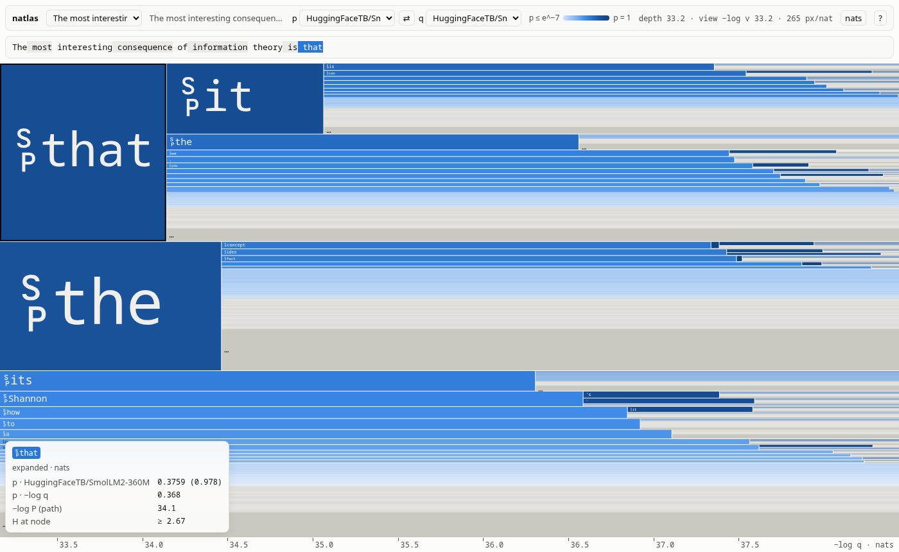
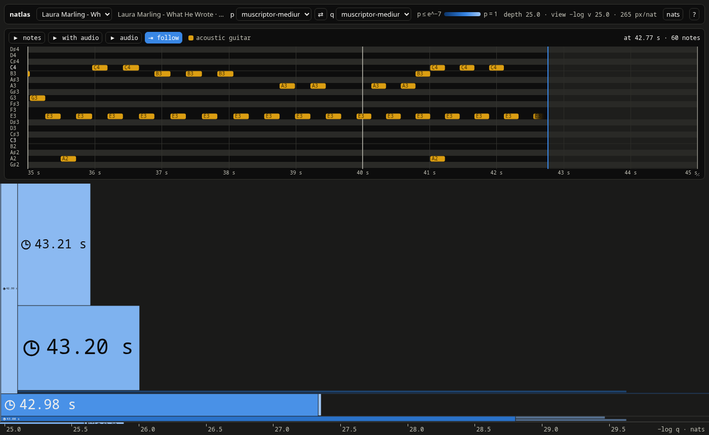
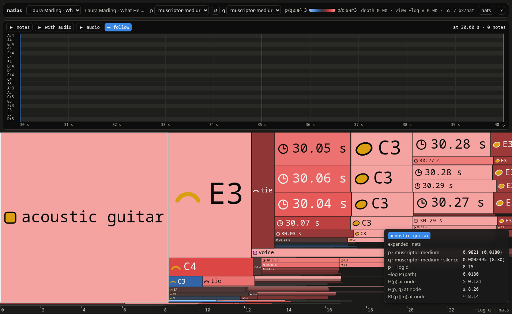

# natlas

A web navigator for distributions over integer sequences, built as the visual client for
[natwalk](https://github.com/khoda81/natwalk). It knows nothing about tokens or
models: a tree is nodes whose children partition their interval, with one
weight per child under each *measure*. A node's children are its 2^32
numbered branches, and what a branch means (a token, a note) comes separately.



A language model's tree of texts: each box is a token, as tall as its
probability and as wide as its surprisal, so a node's boxes cover its entropy.



[MuScriptor](https://github.com/muscriptor/muscriptor) transcribing a
recording: the boxes are its events (time shifts, here), and the panel above
is a piano roll of the path to the hovered box.



The same model with q hearing silence instead: red boxes are events the audio
made likelier, and their extra width is what it told the model, KL(p‖q).

## The picture

Pick one measure **p** and one measure **q** (by default the same). A child of
node N is a box

- **height** ∝ p: N's interval split by p, in p's order of its children,
  recursively, so a box's height is the p-probability of its whole path;
- **width** = −log q nats, starting where N's own box ends, so a box's left
  edge is the q-surprisal of its path.

A node's child boxes therefore cover N's mass × Σ p·(−log q) in area: entropy
when p = q, cross-entropy otherwise. Comparing p with q = p shows KL(p‖q) as the
extra area. Color repeats the conditional p when p = q and shows ln(p/q) per
child otherwise, red where q under-weights it.

## The canvas

Depth is unbounded, horizontal scale is unbounded (it is the base of the log),
and the view is measured from an **origin** node, the root unless a text was
opened without its ancestors. The view height is coupled to depth: with the
left edge at x nats the view spans e^−x of the origin, so a node at the left
edge keeps the same screen height however deep it is. Scrolling deeper is
therefore also zooming in. With p ≠ q the picture depends on the origin, since
x counts q-surprisal while the height follows p.

Opening a text flies there: the servers walk its path and place each branch
along it as they compute it, and the camera descends along the nodes placed so
far, a bar along the top showing how far. Until the whole path is placed the
view asks for nothing else, so the servers spend every turn on the path. Only
the root bounds the view. Past
any other origin, left, above or below, lies its parent, which is fetched as
soon as the view goes there; until it arrives that space stays empty, and then
the parent becomes the origin without moving the picture (with p = q).

Absolute vertical coordinates would lose precision a few dozen nats deep, so
the camera places one point instead: a path of branches below the origin, down
to the deepest node that covers the view, and base-256 digits for the fraction
of that node's p mass above the point (see `core/src/point.rs`). Zooming aims
the point at what is under the pointer and then changes depth alone, and going
up a node keeps every digit, so zooming out and back in returns to the very
same place. An edge is a point too: a run's top, as many digits as the view
that asked for it needs, plus the f64 sum of the weights above it within the
run, so a child keeps its place among its neighbours in any order, however
light it is (see `docs/exact-runs.md`). Each node is laid out from its two edges nearest the point, one binary
search to the first visible child, and children thinner than a physical pixel
join bands about a physical pixel tall (see `core/src/layout.rs`). Touching
bands draw as one silhouette with their individual colors, so internal
antialiased edges cannot show through as stripes. A physical pixel shows, and
the pointer over it selects, the box holding the pixel's top-left corner, so
hovering a box a pixel or two tall never selects its neighbour. The
children of each node are outlined together, a physical pixel of background
at any size: where they start, above the first, below the last, and along
their right edges as they step; siblings part where their widths do, never
by a line between them. The tests pin exact geometry 80
halvings deep and beside children 2^−3000 of their parent.

| input | motion |
|---|---|
| wheel, ← → | deeper / shallower, zooming about the pointer |
| drag | grab and move |
| shift + wheel, ↑ ↓ | along the interval |
| ctrl + wheel, pinch, + − | horizontal scale, about the left edge, leaving the vertical view alone |
| click | glide until a box stands like the root, its children filling the view |
| hover | select a branch by height, then depth; empty space keeps the deepest known subtree selected |
| top path inspector | click the displayed text to edit and search; leaving it shows hovered paths again and keeps the draft for when you come back, Escape or a click on the canvas discards it, and selecting a result or pressing Enter flies there |
| 0 · s · b | back to the root as origin · swap p and q · nats/bits |

## Protocol

`proto/natlas/natlas.proto`, one version: the browser and the servers live in
this repository and change together. A distribution is over sequences of
unsigned 32-bit integers. The empty sequence is the root, and a node's children
are its one-integer extensions, its branches. All 2^32 branches exist; one a
server never lists has weight zero.

Nodes are named on the wire by 64-bit ids hashed from their branches (SplitMix64
over the parent's id and the branch), so the client and every server name a node
alike without exchanging the sequence. A request starts from a node the
server already reached, so it stays small however deep the node is. A server
that has not learned that id (it restarted, or never saw the node) answers
`not_found`, and the client names the node once more from the root with its
whole path.

A node's children are ranked in the order the server keeps: heaviest first,
ties by increasing branch, or by branch (`serve.py --order branch`; the
music scribe always does), and known in **runs** of consecutive ranks. A run
carries its branches, each child's ln weight, and its top: the fraction of
the node above it in base-256 digits, as precise as the view that asked.
Each next edge is the one before plus a child's weight. A run sent more
precisely replaces a coarser one. What lies between runs is a **gap**: its
mass is known, its children are not. A gap is left undrawn, and a child whose q is not yet known reaches
past any view.

The browser sends its current view and optional path to place over
`/session`, one WebSocket per server. The server streams children as runs
of ranks. It places the path first, then prioritizes missing distributions
by how many pixel rows depend on them. If the server does not know an id,
the browser names it with a path from the root. The view's top is encoded
as base-256 digits so deep zooms retain their position.

The Connect `Search(text)` RPC maps text to a token path and teaches the
server the ids along it. The browser searches on input and opens the result
on selection. Music services return `unimplemented` for text search.

Comparing p with q means asking both servers about the same nodes: p's ranks
order and split heights, and q is read by branch for the children p places.
Placed branches use the same colors whether their children are known yet.

The session samples stretches of thin children at two points per physical
pixel row, spread evenly through their mass. Children thinner than a
physical pixel, with the gaps between them, are drawn as bands about a
physical pixel tall, borderless silhouettes whose width Σ p (−ln q) / Σ p is
a Monte Carlo estimate from their known children: exact when p = q and the
band holds no gap, and close for gaps heaviest first, since children sorted
by p have nearly equal surprisal side by side; noisier in branch order.
Touching sibling bands share one contour, filled with a vertical gradient
whose stops retain each band's color. Both of a band's conditional weights
are p-weighted geometric means, so its comparison color shows the children's
mean ln(p/q), while its total path mass is stored separately. Selection
still resolves a band's individual children: on a band's pixel, the pointer
selects the known child the pixel holds rather than a gap between children,
and the highlight outlines the rows of the silhouette that child touches.

Layout draws what the tree holds and redraws when an answer changes it.
A server may also say how many of a node's children have weight. A gap then
shows how many branches it holds. Recordings converted from listings omit
the count.

A `Snapshot` records each node's children with its complete path. The browser
answers from it with the same session logic as the server. Recorded search
includes listed leaves and expanded nodes, and returns an exact match, a
completion, or the deepest recorded prefix. Text with no recorded match
shows an error.
Recordings of runs, the previous format, convert once, without model
inference:

```bash
uv run scripts/migrate-snapshots.py           # all public/data/*.pb
uv run scripts/migrate-snapshots.py tree.pb   # selected files
```

The converter keeps originals in `public/data/.snapshot-backups/runs/`.
Regenerating data is also supported.

The browser saves the origin, the camera's point below it (its path and
digits), its place in the view, horizontal scale and p/q measures to local
storage. Keys include source URLs (or dropped file contents). Reload opens the
node the point's path leads to at once, and shows the saved view once the walk
down from the origin has placed it. A server does not choose
the initial tree or send a starting prompt.

## Live

```bash
bun run live      # SmolLM2-360M on the GPU, at http://localhost:8421
cd export
uv run serve.py --p HuggingFaceTB/SmolLM2-360M \
  --q context:4 --q temperature:1.6
```

`export/serve.py` loads the model and serves all measures over `/session`.
The Connect search endpoints are under `/0/` for the model and `/1/`, `/2/`, …
for the `--q` measures. The root is the empty text; the start-of-text token
is internal to the model. `/manifest.json` describes the measures and
`/labels.json` holds each token's bytes. With `bun run dev` running, the page
finds a local server and lists it first; `?server=URL` points it elsewhere.
Edit the text in the top path inspector and select a result to fly there.

`export/service.py` takes demands from the WebSocket without waiting on the
model. One scheduler thread owns the shared Rust tree and the clients'
sessions: it takes everything posted at once, so a burst of demands while
panning costs one step, sends each client what is new, and submits a pass
of what the clients wait on most: as many distributions as the measure
computes at once, a walk from each client in turn, from the next client in
turn on. The model runs on a
thread of its own, which owns the KV cache, with one pass running and one
queued behind it, so it starts the next the moment one ends while the
scheduler packs the last result. The queued pass is chosen before the
running one's result is known; a new demand or a disconnect withdraws it,
and a pass already running finishes into the cache. Within a client, worth
alone decides.

The scheduler keeps packed distributions within `--cache` GiB (1 by
default), at about four bytes per vocabulary entry. Transformers models
reuse the KV cache of the last path and read ahead in chunks. Float32
results can differ slightly from a position computed alone.

A llama.cpp model reads several paths in one batch. At startup it times
batches of 1, 2, 4, … paths branching off one token and reads as many a pass
as make throughput over latency, k / t(k)², greatest: 4 for Qwen3-4B Q6_K on
a GTX 1660 Ti, where 4 take 29 ms and 1 takes 19 (with an empty KV cache; a
full 4096-cell one adds 12–17 ms). Batched logits round differently from a
token read alone, so a node's numbers depend on its batch, by a KL of about
1e-3 nats; llama.cpp's CPU backend differs from its GPU's by 4e-2. They
already depended on what else the KV cache holds: a token read alone moves
by up to 0.3 in its logits once 1200 cells hold other paths.

Models load in float32 by default, which is both more precise and, on a GTX
1660 Ti, about 5× faster than float16; `--dtype` trades that for memory on
larger models.

`--p` also takes a `.gguf` file, which llama.cpp runs with every layer on the
GPU (`--gpu-layers`, and `--n-ctx` for the KV cache's cells: the deepest
path it can hold, and what paths it keeps beside it). llama-cpp-python is
built for CUDA on first run, which takes a while. The KV cache holds one
sequence per path read, up to llama.cpp's 256, sharing the cells of their
common prefixes. A request reads on from the sequence it shares the most
with, or branches off into a sequence of its own, so walking down a path
costs one token per step, and walks down different branches take turns
without reading each other's tokens again. The least recently read
sequences give way when the cells run out. llama.cpp decodes one token at a
time so a distribution's ranks stay consistent when the server recomputes it.

```bash
uv run serve.py \
  --p ~/.cache/huggingface/hub/models--Qwen--Qwen3-4B-GGUF/snapshots/*/Qwen3-4B-Q6_K.gguf \
  --q temperature:1.6
```

`--q control:FILE` is the same weights steered by a llama.cpp control vector,
read through a context of its own. `steer.py` writes one from MLP neurons, a
dose each times the layer's median residual norm along the neuron's
`W_down` column:

```bash
uv run steer.py Qwen/Qwen3.5-4B L14N8949+1 L13N7956-1 --out evil.gguf
uv run serve.py --p Qwen_Qwen3.5-4B-IQ4_NL.gguf --q control:evil.gguf --n-ctx 4096
```

### Music

```bash
cd export
uv run scribe.py song.mp3 --at 30 --q silence
```

`export/scribe.py` serves [MuScriptor](https://github.com/muscriptor/muscriptor)'s transcriptions of a
recording from `--at` seconds on. MuScriptor writes music 5 seconds at a time,
as MIDI-like events: a tie prologue naming the notes sustained into the
window, then time shifts, instruments, note-ons and note-offs, pitches, drum
hits and an EOS. A path is one transcription of the whole recording, scrolling
through the windows as `TranscriptionModel.transcribe` does, as in natwalk's
MuScriptor demo: EOS is the model's decision to move on, each later window's
prologue is forced from the notes the path leaves sounding (probability one),
a window at MuScriptor's 2000-event limit gets a forced EOS, and the last
window's EOS ends the path. A path's probability is the one MuScriptor's
chunked decoder gives that transcription.

The measures are the model (`--p small|medium|large`) and each `--q`: another
size hearing the same audio, `silence` for the model hearing nothing (p
against it shows what the audio told the model), `instruments:piano,drums`
for the model told what to expect, or `temperature:T`. Each measure keeps a
few KV caches (`--slots`), one per window in reach, stepped back to the prefix
a request shares with what they hold.

`--dtype` sets the transformer weight and KV cache precision for all measures.
Choose `float32`, `float16`, or `bfloat16`. When omitted, MuScriptor uses its
device default. CUDA uses FP16 autocast for the initial pass of each window.

```bash
bun run scribe -- --p large --device cuda --dtype float16 song.mp3
```

Its `/labels.json` is a notes file rather than an array of bytes:
`{"kind": "notes", "frameRate", "window", "windows", "at", "audio", "events":
[[type, value], …], "instruments", "drums"}`. The client reads its kind and
draws each box as its event: a note head for a note-on and a ring for a
note-off in the instrument's color, a tie, a drum ×, a clock with the time in
the recording for a shift, a stop for an EOS. The panel above the canvas
becomes a piano roll of the path, following the window being written: the
hovered event's notes are outlined and a cursor marks the time written so
far. Drag its corner to make it taller; wheel or drag to scroll pitches and
time, ctrl + wheel to zoom time, alt + wheel to zoom pitches. Scrolling or
zooming either stops following it, so the view holds still; ⇥ and ↕ follow,
or a double-click, follow again. Pitches are named as they have room, C
first, then G, E, the rest of C major and the black keys. Hovering a
note names it. Space plays the transcription in view, shift + space plays it
over the recording (`/audio.wav`).

## Data

Datasets live in `public/data/` (git-ignored) with a `manifest.json`: per
dataset, one `.pb` snapshot per measure and a `.labels.json` of each branch's bytes,
base64 in a JSON array. A token can hold part of a character, so the client
decodes a path's bytes together and shows each box as the characters its
token finishes after its ancestors, or as hex where it finishes none.
Snapshots, with or without a labels file, can also be dropped onto the page.

```bash
bun run data      # Zen of Python character n-grams, no ML needed
cd export
uv run hf.py      # Qwen3-1.7B as p, Qwen3-0.6B as q
uv run hf.py --p HuggingFaceTB/SmolLM2-360M --tokenizer HuggingFaceTB/SmolLM2-360M \
  --q context:4 --q temperature:1.6
```

Both use natwalk's own search to discover the tree, then evaluate the other
measures on the same paths, each listed in its own order down to the bit
below its coverage. `hf.py` roots the tree at the empty text too: it records
the path down to the prompt where natwalk's discovery begins. The browser
chooses its own anchor through text search or its saved view. A q measure is another model with the same
tokenizer, `context:N` (p seeing only its last N tokens) or `temperature:T`.

## Development

The source is split by responsibility:

- `core/`: Rust tree, hashed node ids, runs and gaps per measure, the demand
  session for servers and recordings alike, anchored geometry and picking.
- `src/core/`: thin TypeScript adapters to that core, compiled to WebAssembly.
- `src/data/`: live/recorded sources, dataset loading and the read-through
  fetching of what views lack.
- `src/readings/`: text and music readings of branches.
- `src/ui/`: canvas drawing, camera controls, the top path editor, branch details and saved views.
- `export/`: Python model adapters, Connect service and snapshot exporters.

Install [Bun](https://bun.sh), [Rust](https://www.rust-lang.org/tools/install),
[wasm-pack](https://wasm-bindgen.github.io/wasm-pack/installer/) and
[uv](https://docs.astral.sh/uv/). Rust builds to WebAssembly for the browser and
to a native Python module through PyO3/maturin. The Python scripts declare the
local `core/` dependency, so uv builds it automatically. Generated WebAssembly
files and Python wheels are build outputs, kept out of version control.

```bash
bun install
bun run dev       # builds the core, then serves http://localhost:5173
bun run test      # browser adapters + native Rust + Python/Connect tests
bun run typecheck
bun run build     # static site in dist/, including the .wasm and datasets
bun run bench     # browser frame timings and canvas/inspector snapshots
bun run proto     # regenerate TypeScript/Python bindings; needs protoc
```

For faster targeted checks after the core has been built:

```bash
bun test
cargo test --manifest-path core/Cargo.toml
uv run tests/server_test.py   # node naming, walks, windows, transport and migration
```

The Python tests use deterministic distributions and load no model. For manual
browser checks, `PORT=8427 uv run tests/server_test.py --serve` starts the same
fixture, usable through `?server=http://127.0.0.1:8427/`.

See [Rendering performance](docs/performance.md) for the frame ownership model,
benchmark procedure, behavior checks, and the remaining 2 ms budget gap.

The exporters (`export/hf.py`, `export/synthetic.py`) use a
[natwalk](https://github.com/khoda81/natwalk) checkout beside this one;
the live servers need only what their script headers declare, which `uv run`
installs.

## License

[MIT](LICENSE)
