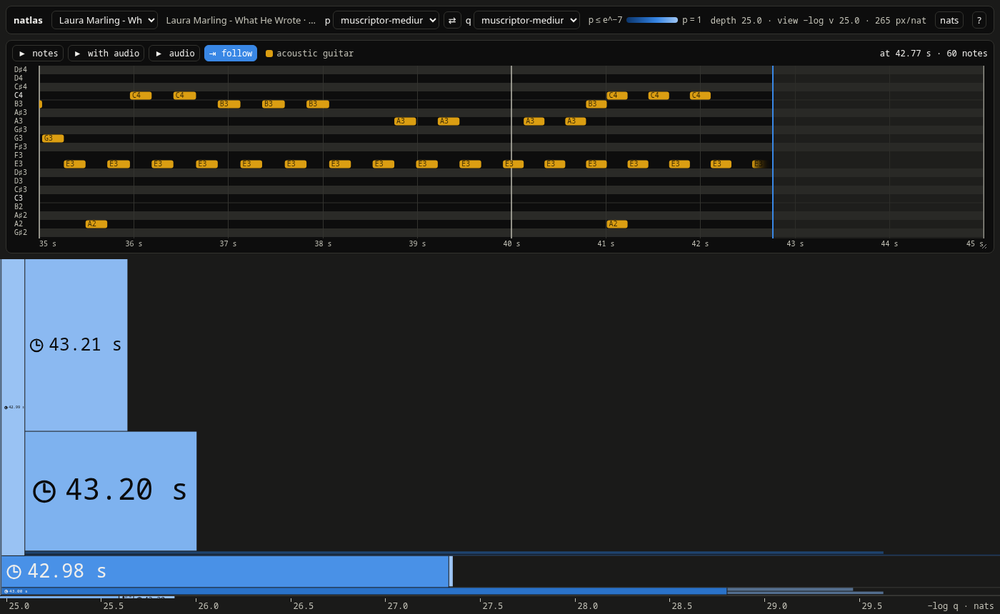
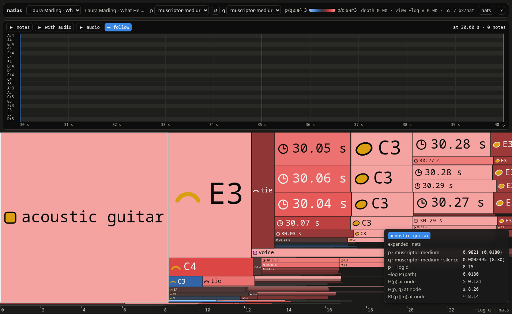

# Music transcription

[Project setup](../README.md) · [Live server endpoints](README.md#live-endpoints) · [Browser controls](../src/README.md#canvas-navigation)

## Run MuScriptor

Run `bun run scribe` from the repository root, or `uv run scribe.py` from
this directory. [scribe.py](scribe.py) listens at http://localhost:8421 and
reads presets and initial recordings from [scribe.toml](scribe.toml).

[MuScriptor](https://github.com/muscriptor/muscriptor) transcribes recordings
uploaded from the page. Select a recording as a new measure's audio, or drop
an audio file on the page to make a measure like $p$ that hears the file.

The boxes are transcription events, in this case time shifts. The piano roll
shows the path to the hovered box.

Here $p$ hears the recording and $q$ hears silence. An event the audio made
likelier is wider than it would be in the $p = q$ view. At each node, the
difference in total child area represents its mass times
$D_{\mathrm{KL}}(p\|q)$.

## Models and measures

A model is a size (`small`, `medium`, or `large`) on a device at a precision,
such as `large/cuda/float16`. Precision `auto` uses MuScriptor's default for
the device. All sizes share the same event labels, which the server can
provide before loading a model. A measure spec can add the following options.

| Option | Effect |
| --- | --- |
| `audio=ID` | Use the recording with this ID. By default the model hears silence. |
| `at=SECONDS` | Start the first window at this time in the recording |
| `instruments=piano,drums` | Tell the model which instruments to expect |
| `temperature=T` | Set the model's temperature |
| `shape=time-area` | Give a node's time shifts the same width, their mean $-\ln p$ weighted by $p$, to preserve their total area |

A measure used as $q$ can supply widths directly. The width of each child is
used as supplied, with no normalization across the node. Each loaded model
keeps a transcriber per recording, start time, and set of instruments. Each
transcriber maintains a few KV caches (`--slots`), one per window in reach.
It steps back to the prefix a request shares with the cache. Measures that
differ only in temperature or shape share their transcriber.

The model's precision sets its transformer weights and KV caches. CUDA uses
FP16 autocast for the initial pass of each window.

## Recordings

`POST /recordings?name=FILE` accepts WAV, formats that SoundFile can read,
and M4A when `ffmpeg` is on the server's `PATH`. It returns an ID hashed
from the original file's bytes so identical files share an ID.
`GET /recordings` lists recordings. `GET /recordings/ID` serves the 16 kHz
audio that the model hears.

The server keeps uploaded files under `recordings/ID/NAME` and model specs
under `models.txt` in its data directory. This defaults to
`$XDG_DATA_HOME/natlas/scribe` or `~/.local/share/natlas/scribe` and can
be set with `--data`. After a restart, the recordings are available again
and the previously loaded models are offered as presets.

## Transcription events

MuScriptor writes five seconds at a time using MIDI-like events. A window
begins with a tie prologue naming sustained notes and continues with time
shifts, instruments, note-ons and note-offs, pitches, drum hits, and an EOS
event. A path has the probability MuScriptor's chunked decoder gives that
transcription, conditioned on the events that make it a valid encoding.

The model's EOS advances to the next window. Later tie prologues are forced
from the notes the path leaves sounding, so their events have probability
one. A window reaching the 2000-event limit gets a forced EOS. The last
window of a recording ends the path. Under silence, windows continue
indefinitely. This follows the windowing of
`TranscriptionModel.transcribe` and natwalk's MuScriptor demo.

## Piano roll

The server's `/labels.json` describes the note events with the fields
`kind: "notes"`, `frameRate`, `window`, `events` (type/value pairs),
`instruments`, and `drums`. The browser's [music reading](../src/readings/music.ts)
draws note-on heads and note-off rings in the instrument's color, as well as
ties, drums, time shifts, and EOS markers. The window count, start, and
audio come from $p$'s recording.

The [piano roll](../src/readings/roll.ts) follows the window being written,
outlines the hovered event's notes, and marks the time reached by the path.
Pitch labels appear as space permits, prioritizing C, then G and E, the
rest of C major, and the black keys. Hover over a note to see its name.

| Input | Action |
| --- | --- |
| Drag the corner | Resize the roll |
| Wheel | Scroll pitches |
| <kbd>Shift</kbd> + wheel | Scroll time |
| Drag | Scroll pitches and time |
| <kbd>Ctrl</kbd> + wheel | Zoom time |
| <kbd>Alt</kbd> + wheel | Zoom pitches |
| **⇥ follow** or **↕ follow** | Resume following time or pitch, respectively |
| Double-click the roll | Resume following both time and pitch |
| <kbd>Space</kbd> | Play the transcription in view |
| <kbd>Shift</kbd> + <kbd>Space</kbd> | Play it over $p$'s recording |
